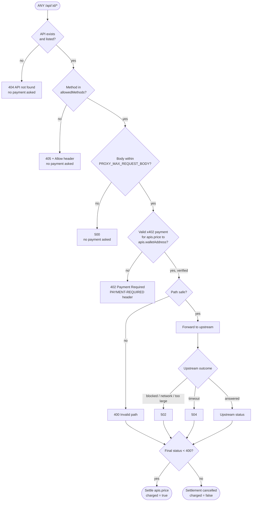

# What a paid call costs

How the gateway decides whether a request to `/api/:id/*` is served, whether
the caller is asked to pay, how much, and whether the payment settles.

This page is checked against `server/src/middleware/apiPaywall.ts`,
`server/src/routes/apis.ts` and `server/src/routes/apis.proxy.test.ts`. If a
change to those files changes this behaviour, update this page in the same
PR.

## The short version

**Every call to a listed API costs the API's single `price`, in USDC, paid to
its `walletAddress`. The payment settles only when the response status is
below 400.** Nothing can waive or change that price: no allowlist, pass, free
quota, credit balance or per-route rule.

### Mechanisms not built yet

Issue #250 lists six ways a call might be covered. Only the last one exists
on `main`:

| Mechanism                        | On `main` | Notes                                                                                                          |
| -------------------------------- | --------- | -------------------------------------------------------------------------------------------------------------- |
| Payer allowlist / denylist       | No        | Work exists on the unmerged `feat/api-gateway-extensions` branch                                               |
| Passes (time-limited access)     | No        | Design only: [adr-time-limited-access-leases.md](adr-time-limited-access-leases.md), written for the old vault |
| Free quota                       | No        | —                                                                                                              |
| Prepaid credits                  | No        | README "Status": not yet built                                                                                 |
| Price rules (per path / method)  | No        | README "Status": per-endpoint pricing not yet built                                                            |
| **Default price** (`apis.price`) | **Yes**   | The only price that is ever charged                                                                            |

When any of these lands, its PR must add its step to the decision order below
and a test for that step. The precedence between them is still undecided. It
should be settled in an ADR in [`docs/adr/`](adr/) before the second
mechanism is merged.

## Decision order

Steps run top to bottom. The first step that responds ends the request.

| #   | Step            | Code                                 | Result if it stops here                      | Caller pays?  |
| --- | --------------- | ------------------------------------ | -------------------------------------------- | ------------- |
| 1   | Look up API     | `loadProxiedApi`                     | `404` if missing or `listed = false`         | Not asked     |
| 2   | Check method    | `loadProxiedApi`                     | `405` with `Allow: <allowedMethods>`         | Not asked     |
| 3   | Read body       | `express.raw({ limit })`             | `500` if over `PROXY_MAX_REQUEST_BODY`       | Not asked     |
| 4   | Require payment | `apiPaywall` → `@x402/express`       | `402` with price, payee, network, scheme     | Asked         |
| 5   | Validate path   | `buildUpstreamUrl`                   | `400 Invalid path` (`..`, encoded `/`)       | No (≥ 400)    |
| 6   | Call upstream   | `sendUpstream`                       | `502` / `504` on failure                     | No (≥ 400)    |
| 7   | Return response | `proxyHandler`                       | Upstream status and body                     | Only if < 400 |
| 8   | Record call     | `res.on("finish")` → `recordApiCall` | Row in `api_calls`, `charged = status < 400` | —             |

The whole request is also bounded by `REQUEST_TIMEOUT_MS` (30 s). If that
fires, the caller gets `503` and is not charged.

### Where the price comes from

- `price` and `walletAddress` are read from the `apis` row **on every
  request**. `loadProxiedApi` does not cache.
- `apiPaywall` caches the x402 middleware for 60 s, keyed on
  `id:price:walletAddress`. A price or payee change gets a new key, so it
  applies to the very next request.
- `amount` in `api_calls` is the price at the time of the call. Revenue in
  `GET /apis/:id/stats` sums `amount` for charged rows only.

## Examples

API `wx1` is listed with `price: "0.01"`, `allowedMethods: ["GET"]`, and the
upstream is `https://weather.example/v1`.

| Request                                  | What happens                                                                 | Charged   |
| ---------------------------------------- | ---------------------------------------------------------------------------- | --------- |
| `GET /api/wx1/today`, no payment         | `402` with price `0.01`                                                      | —         |
| `GET /api/wx1/today`, valid payment      | Forwarded to `/v1/today`; upstream `200`                                     | 0.01 USDC |
| `GET /api/wx1/today`, valid payment      | Upstream `404`                                                               | 0         |
| `GET /api/wx1/today`, valid payment      | Upstream `302` to `https://weather.example/v1/x` (rewritten to `/api/wx1/x`) | 0.01 USDC |
| `GET /api/wx1/slow`, valid payment       | Upstream takes longer than 15 s → `504`                                      | 0         |
| `GET /api/wx1/huge`, valid payment       | Body over 10 MiB → `502`                                                     | 0         |
| `GET /api/wx1/..%2Fadmin`, valid payment | `400 Invalid path`, upstream never called                                    | 0         |
| `POST /api/wx1/today`                    | `405`, `Allow: GET`; no `402` is ever sent                                   | —         |
| `GET /api/wx1/today` after owner unlists | `404`                                                                        | —         |
| Owner changes price to `0.02`            | Next request's `402` asks for `0.02`                                         | —         |

Redirects (3xx) are below 400, so they are charged. The gateway does not
follow them.

## Test coverage

| Behaviour                                | Test (`server/src/routes/apis.proxy.test.ts`)                    |
| ---------------------------------------- | ---------------------------------------------------------------- |
| 404 for unknown API                      | `returns 404 for unknown APIs`                                   |
| 405 before any payment                   | `rejects methods the provider does not allow before any payment` |
| Successful call recorded `charged: true` | `forwards method, path, query and body, injects the secret, …`   |
| Upstream 5xx recorded `charged: false`   | `passes upstream errors through as uncharged calls`              |
| Oversize → 502, slow → 504               | `maps oversize and slow upstream responses to 502/504`           |
| Path traversal refused                   | `buildUpstreamUrl › refuses traversal and smuggled separators`   |

**Gaps:** these tests replace `apiPaywall` with a pass-through, so the `402`
response and the settle/cancel step (steps 4 and 7) are not covered here.
They depend on `@x402/express` and a facilitator. An integration test against
a mock facilitator would close the gap. Unlisted APIs (step 1 with
`listed = false`) and oversize request bodies (step 3) also have no test.

## See also

- [ADR 0001: Settle after response](adr/0001-settle-after-response.md)
- [ADR 0002: Buffer upstream responses](adr/0002-buffer-upstream-responses.md)
- [x402 sequence diagram](x402-sequence-diagram.md)
